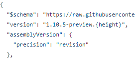
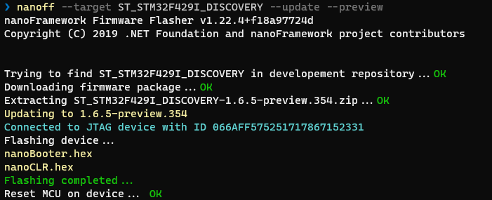
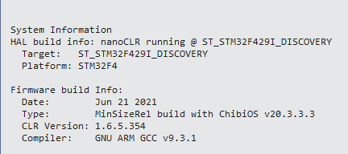

# Package and assembly versions and the native contract hash

Much of the .NET **nanoFramework** is made up of C# classes that invoke code that is in native C++ assemblies.  Some assemblies are just generic C++, others are specific to a hardware platform.

There is an interop framework that assists in handling the interface between C# and C++. That framework includes the generation of a **native contract hash** for a given interface contract. That single value is what the tools and the CLR use to make sure that a managed assembly is paired with a native implementation that agrees with it. There is no native version to maintain by hand.

> This page describes the v2 format (PE files with the `NFMRK2` marker, nanoCLR 2.x and later). Libraries and firmware of the previous generation used a *native methods checksum* together with an `AssemblyNativeVersion` attribute. See [v1 libraries and firmware](#v1-libraries-and-firmware) at the end of this page.

## What has to match

Three things have to be consistent for a deployed application to run. Each one has its own rule:

| What                                                          | Rule                                                                  | Checked by                                                     |
| ------------------------------------------------------------- | --------------------------------------------------------------------- | -------------------------------------------------------------- |
| An assembly that references another assembly                  | Same assembly name and same major and minor version numbers           | NuGet and MSBuild at build time, deploy tools, nanoCLR at load |
| An assembly with native methods and its native implementation | Same native contract hash                                             | Deploy tools, nanoCLR at load                                  |
| The PE files and the firmware                                 | The format of the PE files is the one that the firmware loads         | Deploy tools, nanoCLR at load                                  |

The package version, the firmware version and the native contract hash are independent from each other. The sections below explain how each one is produced.

## What is the native contract hash

The native contract hash is a number computed by the metadata processor from a managed assembly. It changes when something that native code depends on changes, and **only** then:

- A native method (an `extern` method with `MethodImplOptions.InternalCall`) is added, removed or has its signature changed.
- The field layout of any class or struct of the assembly changes (a field added, removed, reordered, renamed or with another type), because native code reads and writes fields by index.

It doesn't change when managed code changes: adding a method, a class or a private helper, changing a method body, or reordering types doesn't affect it. That means that a change in the managed side that has nothing to do with the native side does not require a new firmware.

It's `0` for assemblies without native methods. These don't need any support from the firmware.

The details of what is and what isn't part of the contract, and the algorithm, are in [Native Contract Hash](pe-file/NativeContractHash.md).

## How the native contract hash is generated

As with all of dotnet the nfproj file is actually a MSBuild XML configuration file. Part of the nanoFramework is the `meta-data-processor` (MDP) which is invoked as a post-build task in the MSBuild of the nfproj.

During the post-build the MDP creates stub C++ files for any interfaces that are declared as `InternalCall`.  The stub files are located at bin\debug\stubs\\[assembly-name].  The calculated hash is found in the declaration of the native assembly, in the corlib_native.cpp file in the case of mscorlib:

```cpp
const CLR_RT_NativeAssemblyData g_CLR_AssemblyNative_nanoFramework_System_IO_Hashing =
{
    "nanoFramework.System.IO.Hashing",
    0x639F123B,
    method_lookup,
    ARRAYSIZE(method_lookup)
};
```

The MDP also emits the hash as the `NativeContractHash` output of its MSBuild task and as an environment variable (`NF_NATIVE_CONTRACT_HASH`) and later that is used to embed the hash in the Portable Executable (PE) file that the nanoFramework actually runs. The same value is added to the description and tags of the NuGet package, as described below.

The native methods table of the declaration (`method_lookup`) only has entries for the native methods, in the order of their *native slot*, and nothing for the managed methods. Because of that it doesn't change when managed methods are added to the assembly.

## Process to update a native assembly

Each native assembly has a corlib_native.cpp (and .h) file.  A developer copies any interface changes generated by the MDP stub generation process into the CPP files actually used by the native assembly. The step by step is in the [developer guide](../contributing/developer-guide.md#how-to-call-native-code-from-managed-code). In short:

1. Build the managed assembly. The MDP generates the stubs with the new hash.
1. Copy the changes of the stubs to the files in nf-interpreter, **including the new hash** in the declaration. Don't overwrite the files, they may have more code than the stubs.
1. Implement the native code.

There is no version to bump. If the hash in the declaration is not the one of the assembly (for example because the stubs were not updated) the nanoCLR refuses to load the assembly and the deploy tools report the mismatch before the application is deployed.

**The native implementation must never break the contract that the managed code was built for.** Bug fixes and improvements in the native code are fine, as long as the managed code can't tell the difference except that it's better. Breaking changes are not allowed in the native code. The hash only covers the native signatures and the fields, it can't tell what a native method does, so nothing would warn the existing libraries and applications that the native code now behaves in a different way.

When a breaking change is really needed, it has to **start from the C# API call**: add the new API to the C# library (with its own new `extern` method if it needs native code) and keep the existing one working. If the existing API has to change or to be removed, that is a managed breaking change and the version of the library is bumped for it (see below). The hash changes by itself because of the new native method. The details are in the [versioning policy](../contributing/versioning-policy.md).

## Assembly references and the minor version

The references from one assembly to another one are resolved by name, and the version of the referenced assembly has to have the same major and minor numbers as the one that was used to build the application. Build and revision numbers are not compared.

That makes a minor version bump a deliberate decision: it means a *managed binary breaking change* that forces everything that depends on the library to be updated and rebuilt. It isn't used for the native side, because the native code is not allowed to break the contract. The native contract hash is what tells the tools and the nanoCLR if a library and a native implementation match.

## How the NuGet package version is generated

The assemblies in the nanoFramework use the nerdBank GitVersion NuGet component to manage NuGet versions.  There is a version.json file in the GIT repository root - here is a screen print for CoreLibrary:
>

The {height} placeholder is filled out by the nerdBank component.  It is the number of commits since the last time the version.json file was changed to a new version number.  Note that the number will always increment, but it is not like a build number in that you may not start at 1, and it may not increment by 1.  But the version number will always be numeric and greater than the previous version.  Changing the version info in the file will cause the counter to start back around 1 - this depends on how many commits are in the first build after updating the version info.

The developer manually updates the NuGet package version prefix when there are breaking changes to the managed interface of the library, so that its dependents have to be rebuilt. Code changes that don't break the interface will just get a new "height" as changes are committed and built.

## What a NuGet package says about the native side

The packages of libraries with native code include the native contract hash in the description and in the tags, which are generated at build time. For example, for CoreLibrary:

- Description: *This package requires a target with mscorlib native contract hash 0x532E6934.*
- Tag: `nfnc-0x532E6934`

To know which package versions work with a firmware, compare that hash with the one that the firmware has for the assembly (see below). Packages with the same tag were built against the same native contract.

The build of every pull request in the repositories of the class libraries compares the hash with the one of the latest published package. If it changed, the pull request gets a comment and a tracking issue is opened in the Home repository, as the native declaration in nf-interpreter has to be updated before the package is released. If the hash didn't change, there's nothing to do on the native side. This check no longer blocks a pull request for a missing native version bump, because there's no version to bump.

## Firmware versions and native assemblies

Firmware is built automatically for a standard set of device targets.  The firmware version is independent from the assembly versions, but the latest firmware always uses the latest native assembly declarations and will work with the latest NuGet package versions of a component. Here is a screen shot of `nanoff` installing the latest preview version of the firmware from the Cloudsmith.io repository:

>

Each firmware package includes a `native_assemblies.json` file with the name and the native contract hash of each native assembly in that firmware, the target name and the version of the nanoCLR. The same information is reported by the device itself.

Here is a screen shot from using the **Device Capabilities** of the **Device Explorer** in Visual Studio to see what version of the firmware is installed. The same window lists the native assemblies that were included in that firmware version with the native contract hash of each one:

>

## v1 libraries and firmware

The format of the PE files changed in v2 and so did the way the native side is checked:

- The nanoCLR 2.x and later only loads v2 PE files (`NFMRK2`) and, for assemblies with native methods, requires that the native contract hash matches. There's no support for loading v1 PE files in a v2 firmware.
- The deploy tools know which format to use from the version of the nanoCLR that the device reports: nanoCLR 2.x and later means v2 PE files, 1.x means v1. They don't allow deploying a mix of formats and report a clear message when the libraries and the firmware don't belong to the same generation.
- Libraries and firmware of the previous generation (nanoCLR 1.x) keep working with their *native methods checksum* and *native version* as before.
- These assemblies had a second value, the native version, that a developer had to set by hand in the `AssemblyInfo.cs` of a library (the `AssemblyNativeVersion` attribute) and bump whenever the checksum changed. It didn't add any information to the checksum and it blocked the deployment of a library after changes that only affected the native side. That attribute is not used anymore. There is nothing to maintain: when the native contract of an assembly changes the hash changes by itself.

To move a project to v2, update the nanoFramework NuGet packages to the versions built for v2 firmware and use the up to date Visual Studio extension, so the project is built with the v2 tools.
