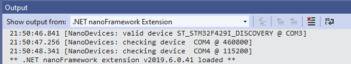

# Getting Started Trouble Shooting Guide

Here are solutions to some common problems when getting started.

## No devices appear in **Device Explorer** in Visual Studio (View/Other Windows/Device Explorer)

- The **Visual Studio nanoFramework Extension** communicates to the device using serial/COM ports.  The extension must first detect that the COM port is active, and then ping the port for a response to a specific query.  The device drivers for serial ports come in many flavours and versions, and are probably the #1 problem with detecting and communicating with a device.  Install the latest drivers for the USB chipset used by your board.  Check the version using Windows Device Manager.  
- Sometimes unplugging and replugging the USB port will "wake up" a serial device driver
- Try pressing the RESET button on your device to reboot it
- Reflash your device to make sure it has nanoFramework installed
- On the **Device Explorer** enable the **Show Internal Errors** button . Check for messages in the Visual Studio Output Window and select **.Net nanoFramework Extension** in the `Show output from:` dropdown. <BR/>
- Toggle the **Disable Device Watchers** button  on the **Device Explorer** ON then back OFF.  This will cause the extension to rescan all of the COM ports.
- Try a different USB cable, or test cable on a known good device.  Sometimes it is difficult to tell if a cable was only intended to be used for charging and does not carry the signal wires.  Cables over 2M/6FT are to be suspected since those are often power only cables.
- Some STM32 devices need to use two USB cables - one for power and one for serial/COM. See [Getting Started Guide for managed code (C#)](../getting-started-guides/getting-started-managed.md).

## When you attempt to debug you get a deployment error and you see a message "Couldn't find a valid assembly required by mscorlib..." in the Output Window/.NET nanoFramework Extension

- The managed assemblies of the application and the firmware of the device are not aligned. Before deploying, the extension compares the PE files with what the firmware reports and the Output Window/.NET nanoFramework Extension shows what is wrong:

  - *The target has the wrong version for the following assembly(ies)*: the PE file requires a native contract hash that is different from the one of the native assembly in the firmware. The message shows both hashes.
  - *The target does not have support for the following assembly(ies)*: the firmware doesn't have the native assembly that the PE file needs. Check if the firmware image was built to include it.
  - *The target can't load the following PE file(s), they have the wrong format*: the PE files are from the previous generation (v1) and the firmware is v2, or the other way around. Update the firmware, or the NuGet packages and the Visual Studio extension, so they are of the same generation.
  - *The following assembly reference(s) can't be resolved*: an assembly references another one with a major or minor version that is not the one being deployed. The NuGet packages of the project are not consistent.

- The C# and native C++ assemblies are not aligned. That's determined by the NuGet package version of the component you selected and by the firmware installed on the device. nanoFramework.CoreLibrary is the most common problem seen since it tends to load early.
- The description of the NuGet package will contain the native contract hash that is required (and it's also in the package tags, as `nfnc-` followed by the hash).
- See [Guide for package and assembly versions and the native contract hash](../architecture/guide-version-checksums.md) for more info.
- Use the **Device Capabilities** button  on the **Device Explorer** to see what native assemblies and native contract hashes are installed on the device as part of the firmware.
- If you are changing a nanoFramework component and you change the interface/contract of either the C# code or the C++ code, the native contract hash changes and you will get this kind of error until the firmware and the library are rebuilt together. There is no native version to bump: the hash is generated automatically.

## nanoff does not load correct version of firmware

- Clear the cache at [username]\\.nanoFramework\\[device-name] - or just delete all of the cache folders.
- Use the **Device Capabilities** button  in the **Device Explorer** to verify the firmware version that is installed on the device.

## nanoff ends with Ennnn error

- Update your copy of the `nanoff` tool using the command

    ```console
    dotnet tool update nanoff --global
    ```

- Run `nanoff` again, this time with detailed output messages by adding `-v diag` at the end. This will output verbose messages on the progress of the tool execution, hopefully detailing what could be wrong.
- Make sure you have the latest drivers of the serial devices connected. Check the driver manufacturer website as not all of them make available the latest versions through Windows Update.
- Check permissions for the cache folders at [username]\\.nanoFramework.  Deleting the cache files can sometimes fix problems.
- Like the **Device Explorer** the flash utility depends on serial/COM drivers for most devices.  Check that USB cables are not power-only cables (i.e. no signal wires), and that you are using the most recent USB drivers.

## nanoff failed to read from ESP32 flash (E4004)

- This is due to the nanoff will try to read and backup config partition before the actual flash.
- If the chip is flashed with something else before (e.g. Arduino), it will cause a read error and stop the process.
- Add `--masserase` to bypass the backup process and erase the flash.

## nanoff failed to read from ESP32 chip (E4000)

- This is most likely due to the fact that the device needs to be placed manually into boot mode.
- You will have to handle the `reset` button, press the `boot` button, then release the `reset` button. This places the device into boot mode. It is strongly recommended to close Visual Studio during this process.
- The serial port can change! So, make sure you are checking the new port number.
- Once flashed, the device needs to be rebooted manually (press the reset button or disconnect and reconnect the device) to be seen by Visual Studio.
